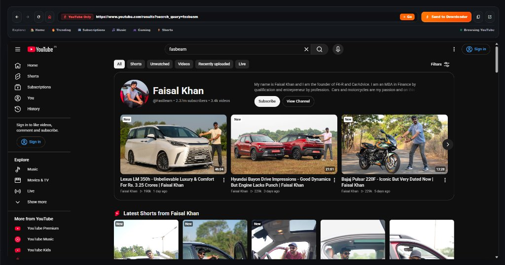
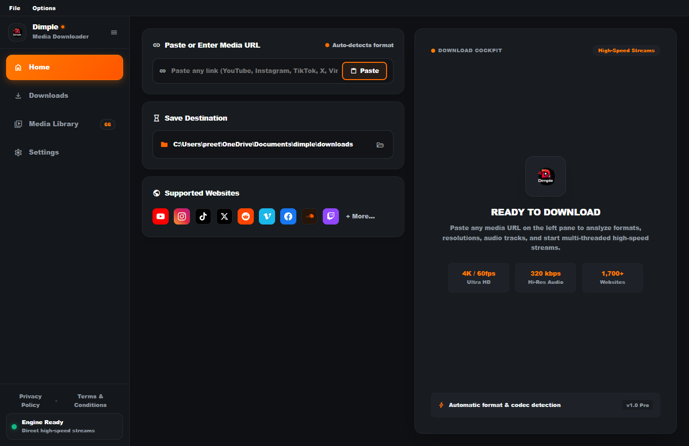
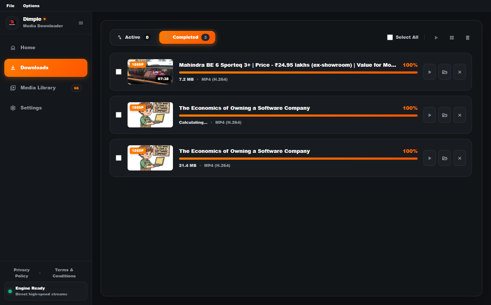
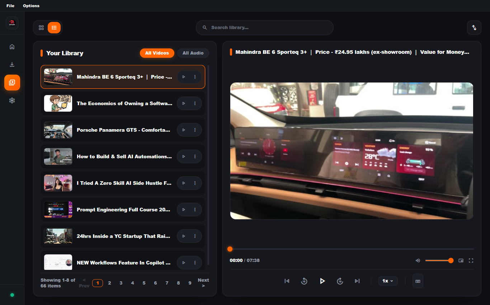
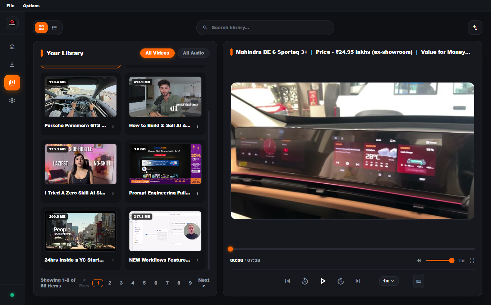
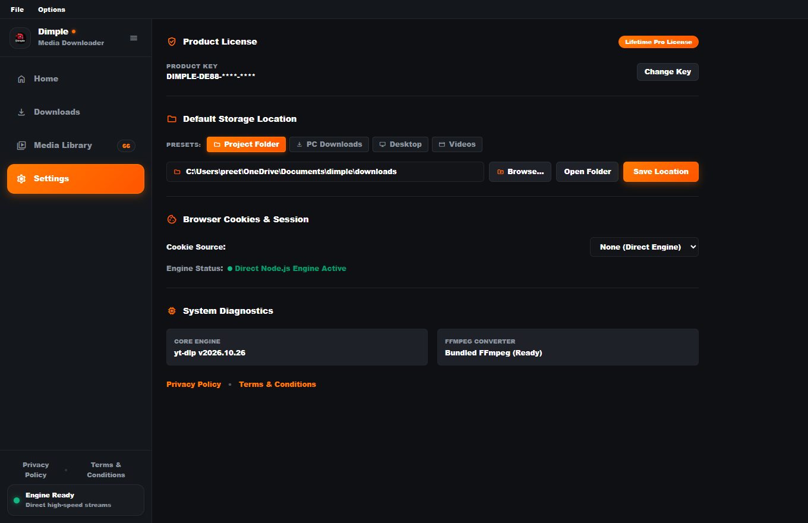
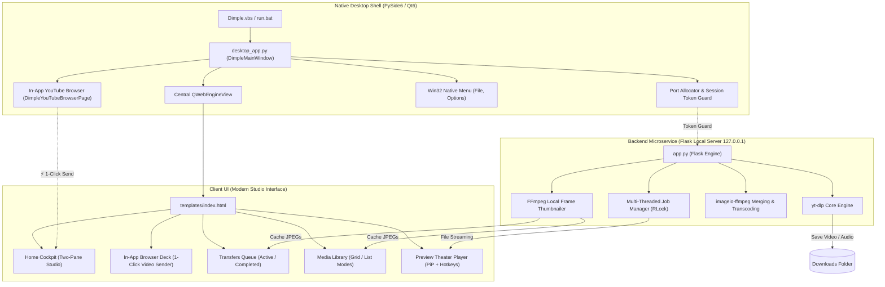

<p align="center">
  
</p>

<p align="center">
  <a href="#-open-source-license"></a>
  <a href="#-open-source-license"></a>
  <a href="#-open-source-license"></a>
  <a href="#-key-features"></a>
  <a href="#-tech-stack"></a>
  <a href="#-tech-stack"></a>
  <a href="#-tech-stack"></a>
  <a href="#-supported-platforms"></a>
</p>

<p align="center">
  <strong>Next-Generation Desktop Media Downloader, In-App YouTube Browser &amp; Dedicated Theater Workstation</strong><br>
  100% Free, Fully Unlocked &amp; Open Source under the MIT License. High-concurrency downloads, seamless in-app streaming, instant Picture-in-Picture playback, and zero license keys required.
</p>

<p align="center">
  <a href="#-visual-interface-showcase">Screenshots</a> •
  <a href="#-key-features">Key Features</a> •
  <a href="#-in-app-youtube-browser">In-App Browser</a> •
  <a href="#-quick-start--installation">Quick Start</a> •
  <a href="#-keyboard-shortcuts">Shortcuts</a> •
  <a href="#-architecture">Architecture</a> •
  <a href="#-cli-power-mode">CLI Mode</a> •
  <a href="#-open-source-license">License</a>
</p>

---

## ⚡ Overview

**Dimple** is an ultra-fast, production-grade media downloader, in-app YouTube browser, and local theater suite built natively for Windows. Combining the hardware-accelerated speed of **PySide6 (Qt6 WebEngine)** with a hardened local **Flask micro-engine**, **`yt-dlp`**, and bundled **FFmpeg**, Dimple delivers:

- 🌐 **Embedded In-App YouTube Browser**: Browse, watch, and search YouTube directly inside the app with a compact, container-free toolbar and 1-click video dispatching.
- 🚀 **Zero-latency concurrent downloads**: Multi-threaded queue engine with live transfer speeds, byte progress gauges, and real-time countdown ETA clocks.
- 🎬 **Dedicated Theater Preview Player**: Picture-in-Picture (PiP), multi-speed stepping (`0.5x`–`2x`), interactive timestamp scrubber, and YouTube hotkey integration.
- 📂 **Dual-View Offline Showcase**: Responsive 2-column Grid & compact List views with real-time filtering, multi-criteria sorting, and frame-accurate local thumbnail caching.
- 🔓 **100% Free & Open Source**: Fully unlocked forever under the permissive MIT License. Zero activation keys, zero paywalls, zero ads, and zero telemetry.

---

## 📸 Visual Interface Showcase

<table width="100%">
  <tr>
    <td width="50%" align="center">
      <br>
      <b>🌐 In-App YouTube Browser &amp; 1-Click Video Sender</b><br>
      <i>Sandboxed Chromium engine, ultra-compact single-row command deck, on-player floating button, and edge-to-edge canvas.</i>
    </td>
    <td width="50%" align="center">
      <br>
      <b>🏠 Home Studio Cockpit</b><br>
      <i>Automatic clipboard link analysis, real-time resolution discovery, directory presets, and batch dispatching.</i>
    </td>
  </tr>
  <tr>
    <td width="50%" align="center">
      <br>
      <b>📥 Active &amp; Completed Transfers Queue</b><br>
      <i>Multi-threaded progress gauges, live speeds, format badges, pause/resume, and native Explorer reveal.</i>
    </td>
    <td width="50%" align="center">
      <br>
      <b>🎬 Dedicated Preview Theater</b><br>
      <i>Full viewport player, Picture-in-Picture (PiP), volume sliders, frame-accurate scrubbing, and hotkeys.</i>
    </td>
  </tr>
  <tr>
    <td width="50%" align="center">
      <br>
      <b>🖼️ Offline Media Library (Responsive Grid View)</b><br>
      <i>2-column responsive layout, frame-accurate FFmpeg thumbnails, instant search, and multi-criteria sorting.</i>
    </td>
    <td width="50%" align="center">
      <br>
      <b>⚙️ Settings &amp; Preferences Hub</b><br>
      <i>Configurable download presets, browser cookie integration, engine diagnostics, and open-source license status.</i>
    </td>
  </tr>
</table>

---

## ✨ Key Features

### 🌐 In-App YouTube Browser & 1-Click Video Sender
- **Embedded Chromium Web Engine**: Native QtWebEngine browser directly embedded into the application workspace.
- **YouTube Sandboxing**: Dedicated secure browsing restricted to YouTube channels, searches, and shorts.
- **⚡ 1-Click Direct Video Sender**: When watching any YouTube video, click **"Send to Downloader"** on the top command deck or the floating on-player button to automatically send the video to Downloader Studio and start format discovery.
- **Ultra-Compact Single-Row Bar**: Streamlined toolbar with <kbd>Back</kbd>, <kbd>Forward</kbd>, <kbd>Reload</kbd>, <kbd>Home</kbd>, clean omni-address bar, and external browser fallback.
- **Collapsible Minimalist Sidebar**: Sidebar starts collapsed (`68px`) by default for an unobstructed media canvas, expanding smoothly when clicking the menu button.

### 📥 High-Speed Multi-Threaded Engine
- **Simultaneous Job Processing**: Queue multiple videos or playlists concurrently without thread locking or UI freezing.
- **Smart Queue Telemetry**: Live progress bars (`0–100%`), real-time transfer speeds (`MB/s`), byte gauges (`GB/MB downloaded`), and countdown ETA clocks.
- **Job Lifecycle Controls**: 1-click Pause, Resume, Retry, Cancel, Remove, and Batch Clear completed jobs.
- **Native File Explorer Integration**: Click the folder icon on any download card to instantly reveal and select the downloaded file in Windows Explorer.

### 🎬 Dedicated Preview Player Theater
- **Picture-in-Picture (PiP)**: Pop out any playing video into a floating always-on-top window (<kbd>P</kbd>) to watch while multitasking across other desktop apps.
- **YouTube Hotkey Integration**: Full muscle-memory keyboard controls (<kbd>Space</kbd>/<kbd>K</kbd>, <kbd>J</kbd>/<kbd>L</kbd>, <kbd>M</kbd>, <kbd>F</kbd>, <kbd>[</kbd>/<kbd>]</kbd>).
- **Interactive Scrubber with Hover Tooltips**: Hover over the progress bar to preview exact timestamps with smooth drag-to-seek functionality.
- **Multi-Speed Playback**: Seamless 0.5x, 0.75x, 1x, 1.25x, 1.5x, and 2x rate adjustments.

### 🖼️ Dual-Mode Media Library
- **Grid View & List View**: Switch between an image-rich 2-column card showcase and a sleek, compact list with 1-click view toggles.
- **Smooth Custom Scrolling**: High-performance vertical scroll container with custom scrollbars and smooth wheel handling.
- **Instant Search & Sort**: Real-time substring filter and multi-criteria sorting (Newest, Oldest, Name A–Z, Name Z–A, Size Largest, Size Smallest).
- **Frame-Accurate Local Thumbnails**: Automated FFmpeg extractor grabs crisp 480p preview posters directly from media files with multi-seek fallback.

### 🔓 100% Free & Open Source (No Keys Needed)
- **Zero Activation Keys**: No license keygen, no serial numbers, no activation dialogs, and no registration.
- **All Features Unlocked**: Unlimited concurrent downloads, 4K resolution, 320 kbps MP3 conversion, and unrestricted bandwidth.
- **Permissive MIT License**: Free for personal, educational, and commercial use.

### 🎵 Universal Format & Resolution Suite
- **Video Qualities**: `Best Available`, `4K 60fps (2160p)`, `1440p (2K)`, `1080p (Full HD)`, `720p (HD)`, `480p`, and `360p`.
- **Audio Extraction**: Ultra-pure MP3 encoding at `320 kbps` (Master Quality) or `128 kbps` (Standard) with automated metadata tagging.
- **Bundled Stream Merging**: Integrated `imageio-ffmpeg` automatically merges separate high-res video and audio tracks without external command-line dependencies.

---

## ⌨️ Keyboard Shortcuts

Dimple provides full YouTube-standard keyboard hotkeys for an intuitive, hands-on-keyboard experience:

| Key | Action | Context |
| :---: | :--- | :--- |
| <kbd>Ctrl</kbd> + <kbd>1</kbd> | Switch to Home (Downloader Studio) | Global |
| <kbd>Ctrl</kbd> + <kbd>2</kbd> | Switch to In-App YouTube Browser | Global |
| <kbd>Ctrl</kbd> + <kbd>3</kbd> | Switch to Active Transfers Queue | Global |
| <kbd>Ctrl</kbd> + <kbd>4</kbd> | Switch to Media Library Showcase | Global |
| <kbd>Ctrl</kbd> + <kbd>,</kbd> | Switch to Settings &amp; Preferences | Global |
| <kbd>Ctrl</kbd> + <kbd>V</kbd> | Paste URL &amp; auto-analyze from clipboard | Home Tab |
| <kbd>Space</kbd> or <kbd>K</kbd> | Play / Pause video toggle | Media Theater |
| <kbd>J</kbd> | Rewind 10 seconds | Media Theater |
| <kbd>L</kbd> | Fast-forward 10 seconds | Media Theater |
| <kbd>←</kbd> | Rewind 5 seconds | Media Theater |
| <kbd>→</kbd> | Fast-forward 5 seconds | Media Theater |
| <kbd>↑</kbd> | Increase volume by 5% | Media Theater |
| <kbd>↓</kbd> | Decrease volume by 5% | Media Theater |
| <kbd>M</kbd> | Mute / Unmute audio | Media Theater |
| <kbd>F</kbd> | Toggle Fullscreen | Media Theater |
| <kbd>P</kbd> | **Toggle Picture-in-Picture (PiP)** | Media Theater |
| <kbd>[</kbd> | Previous media item | Media Library |
| <kbd>]</kbd> | Next media item | Media Library |
| <kbd>&lt;</kbd> / <kbd>&gt;</kbd> | Decrease / Increase playback speed | Media Theater |
| <kbd>0</kbd> – <kbd>9</kbd> | Seek to 0% – 90% duration of video | Media Theater |
| <kbd>Esc</kbd> | Close shortcuts guide &amp; modals | Global |

---

## 🌐 Supported Platforms

Powered by `yt-dlp`, Dimple supports **over 1,700+ websites and services**, including:

<p align="left">
  
  
  
  
  
  
  
  
  
  
  
</p>

---

## 🏗️ Architecture

Dimple is structured with clear separation between native window lifecycle, local server isolation, background worker threads, and client-side reactive rendering:



---

## 🚀 Quick Start & Installation

### Option 1: Native Windows Launcher (Recommended)
Double-click **`Dimple.vbs`** in the application root directory:
- Launches the desktop application silently without opening any background Command Prompt or terminal console.
- Automatically handles free loopback port discovery and security token authentication.

### Option 2: Run via Command Prompt / PowerShell
```powershell
# 1. Clone repository
git clone https://github.com/TauruSilv3R/dimple.git
cd dimple

# 2. Create virtual environment
python -m venv .venv
.venv\Scripts\activate

# 3. Install dependencies
pip install -r requirements.txt

# 4. Launch Desktop App
python desktop_app.py
```

Or execute the batch launcher directly:
```cmd
run.bat
```

---

## 💻 CLI Power Mode

Dimple includes a standalone CLI interface that allows you to download media directly from terminal scripts, command prompts, or task schedulers:

```powershell
# Download best available quality to the default folder
python app.py "https://www.youtube.com/watch?v=VIDEO_ID"

# Download to a specific custom directory
python app.py "https://www.youtube.com/watch?v=VIDEO_ID" --dir "D:\Media\Music"

# Download specific resolution (e.g. 1080p Full HD)
python app.py "https://www.youtube.com/watch?v=VIDEO_ID" --quality 1080

# Extract audio as high-bitrate MP3 (320 kbps)
python app.py "https://www.youtube.com/watch?v=VIDEO_ID" --quality audio_320
```

---

## 🛡️ Git Configuration & Privacy

Dimple is configured with a comprehensive, production-ready [`.gitignore`](file:///.gitignore) that ensures your personal media files, cache, and build artifacts remain safe, clean, and private:

```gitignore
# Excluded from Version Control:
downloads/                 # User downloaded videos and audio (prevents repository bloat)
*.mp4, *.mkv, *.webm, ...  # Raw media files
.thumbnails/               # Dynamically generated JPEG cache
jobs.json, config.json     # Local task queues and saved directories
cookies.txt, *.cookies     # Private browser session cookies
dist/, build/              # Binary compiler outputs
.venv/, venv/              # Python virtual environment binaries
```

---

## 📦 Tech Stack

- **GUI Framework**: [PySide6](https://pypi.org/project/PySide6/) (Qt6 WebEngine + Widgets)
- **Backend Core**: [Flask](https://flask.palletsprojects.com/) + WSGI Local Loopback
- **Download Engine**: [yt-dlp](https://github.com/yt-dlp/yt-dlp)
- **Audio/Video Transcoder**: [imageio-ffmpeg](https://github.com/imageio/imageio-ffmpeg)
- **Typography & Icons**: Material Symbols Outlined, JetBrains Mono, Arial Black
- **Styling**: Tailwind CSS (bundled locally for 100% offline support)

---

## 📄 Open Source License

This project is licensed under the **[MIT License](LICENSE)**:

```text
MIT License

Copyright (c) 2026 Dimple Open Source Contributors

Permission is hereby granted, free of charge, to any person obtaining a copy
of this software and associated documentation files (the "Software"), to deal
in the Software without restriction, including without limitation the rights
to use, copy, modify, merge, publish, distribute, sublicense, and/or sell
copies of the Software, and to permit persons to whom the Software is
furnished to do so, subject to the following conditions:

The above copyright notice and this permission notice shall be included in all
copies or substantial portions of the Software.
```

> [!NOTE]  
> Dimple is designed for downloading publicly available personal media, creative commons content, and educational archives. Please respect the terms of service of each platform and copyright laws in your jurisdiction.

<p align="center">
  <b>Dimple Media Workstation</b> • Crafted for Performance, Freedom &amp; Simplicity
</p>
